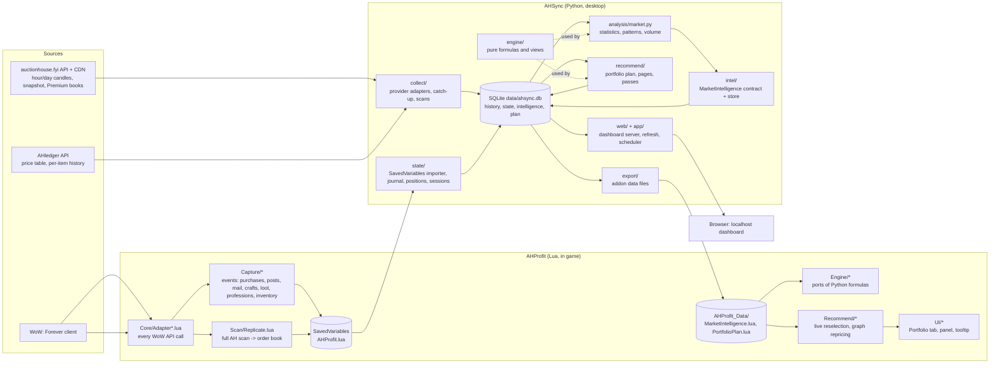

# Architecture

The high-level design: components, boundaries and data flows, kept current with every milestone. The detail lives in [SPEC.md](SPEC.md) (§5.0 components and contracts, §5.2 failure modes, §3.2 storage, §4.0 the app/addon split); this page is the map. Diagrams are Mermaid.

Maintenance rule (CLAUDE.md "How work is run"): a milestone that adds, removes or re-routes a component, a table family, a source or a contract updates this page in the same commit. The orchestrating model does it, never a routine subagent.

## 1. Components

Two programs and three data sources, talking only through files and versioned contracts.



Boundaries that matter:

- `engine/` is pure: data in, numbers out, no I/O or clock. Every displayed number is made there (SPEC §8.5).
- I/O lives at the edges (`collect/`, `db/`, `history/`, `state/`, `intel/store.py`, `export/`, `web/`), each taking a transport, clock or database so tests inject fakes.
- The addon touches WoW only through `Core/Adapter*.lua`; the addon only looks up and compares, never computes history (SPEC §4.0, §5.1).
- Sources are interchangeable behind the source tag (`src`) on every stored row; analysis picks by rule, never by name (SPEC §2.2, §5.0).

## 2. Market data flow: sources to intelligence to the addon

```mermaid
flowchart TD
  AHF[AHF hour files, snapshot, Premium books] -->|src ahf, kind hourly / book| Store
  AHL[AHledger price table every 30 min<br/>per-item history backfill] -->|src ahledger (table), ahledger_h1 (hourly)| Store
  Scans[Your full scans from SavedVariables] -->|src local, kind book| Store
  Store[(candles_h1 / candles_d1 / current<br/>scans + book_entries<br/>volume_d1 + volume_cover<br/>observed_hours)]
  Store --> Reads[history/reads.py<br/>one bulk read per market]
  Reads --> Pick["one close per (item, hour):<br/>kind book > hourly > table,<br/>then local, then config rank"]
  Pick --> Analysis[analysis/market.py<br/>medians, percentiles, 168-slot patterns,<br/>seasonality, sell windows, sales volume]
  Analysis --> Intel[(intel: MarketIntelligence<br/>one ItemIntel per item, versioned)]
  Intel --> Plan[recommend/portfolio.py<br/>candidates, selection, accounting]
  Intel --> Export[export/market_lua.py<br/>MarketIntelligence.lua]
  Plan --> ExportPlan[export/plan_lua.py, portfolio_lua.py<br/>PortfolioPlan.lua]
  Export --> Addon[Addon: tooltip, panel, live reselection]
  ExportPlan --> Addon
```

Rules encoded in this flow (SPEC references): the full refresh is the only heavy pass and runs once a day (§3.1.1); re-plans after a SavedVariables read touch only the plan and pages from the published intelligence, under one second (§3.1.2); publication is staging tables plus an atomic swap (§5.2); the addon files carry a schema and export version and the addon refuses mismatches (§3.5).

## 3. Player data flow: the game to positions, history and rates

```mermaid
flowchart TD
  Game[Game events] --> Capture[Capture/*: purchases, posts, auction mail,<br/>payouts, crafts, disenchants, sent mail,<br/>loot (gather), professions, inventory snapshots]
  Capture --> SV[(SavedVariables AHProfit.lua<br/>events kept until ingested)]
  SV -->|file watcher, 2 s debounce| Importer[state/importer.py<br/>idempotent by event id; ingestedUntil per character]
  Importer --> Journal[(state tables: journal, inventory,<br/>own_auctions, cost_basis, gather_events)]
  Journal --> Tracking[recommend/tracking_pass.py<br/>match events to plan actions]
  Tracking --> Positions[engine/positions.py + state/positions.py<br/>open on a funded buy or craft, replay lots and events,<br/>reconcile against snapshots]
  Journal --> Sessions[engine/sessions.py + state/gathering.py<br/>farming sessions: 20 units confirm, 15 min ends]
  Positions --> Accounting[committed capital = cost left of open positions]
  Accounting --> Plan[the portfolio plan]
  Positions --> History[History page: expected vs realized per position]
  Sessions --> Gathering[Gathering page: items/hr, net gold/hr]
  Importer -->|re-plan| Plan
  Plan --> Export[PortfolioPlan.lua]
  Export --> AddonLocal[Addon: local positions until AHSync reads them]
```

Rules: a sale is never inferred from missing inventory alone (§3.4D.9); events are never deleted before AHSync has stored them (§2.2 pruning handshake); the addon's newer events win over an older snapshot until the next export (§4.0).

## 4. Scheduling and the dashboard

```mermaid
sequenceDiagram
  participant S as app/scheduler.py
  participant C as collect/
  participant R as app/refresh.py
  participant P as recommend passes
  participant W as web/server.py
  S->>C: hourly :06 store hour (AHF), every 30 min AHledger table
  S->>R: daily full refresh (analysis, intelligence, plan, pages, export)
  Note over S,R: SavedVariables changed -> state import -> re-plan -> pages -> export
  S->>P: hourly status pass (positions re-evaluated, Status lines)
  W->>W: GET pages serve stored JSON (<= 50 ms); POST only for risk tolerance and manual rates, Host/Origin/token checked
```

## 5. Storage families (SQLite)

| Family | Tables | Written by | Read by |
|---|---|---|---|
| Market history | `candles_h1`, `candles_d1`, `current`, `scans`, `book_entries`, `volume_d1`, `volume_cover`, `sales_h1`, `observed_hours`, `ahledger_rows`, `source_state`, `sync_state`, `fetch_failures` | `collect/` | `history/reads.py` |
| Items | `items` | `collect/` | everywhere, via the catalog |
| Intelligence | `intel` (+ `_new` staging) | `analysis/` via `intel/store.py` | `recommend/`, `export/` |
| Player state | inventory, journal (`purchases`, `posts`, `auction_mail`, `payouts`, `crafts`, `disenchants`, `mail_sent`), `professions`, `recipes`, `known_recipes`, `characters`, `cost_basis`, `gather_events`, `farming_sessions`, `manual_rates`, `positions`, `position_lots` | `state/` | `recommend/`, `app/` |
| Plan and pages | `actions`, `alternatives`, `export_candidates`, `portfolio_snapshot`, `views` (+ `_new` staging), `item_rules`, `reserves`, `sell_records` | `recommend/` | `export/`, `web/` |
| Operations | `status`, `meta`, backups on disk, raw snapshots on disk | all | Status page |

## 6. Change log of this page

- 2026-11-01: created at the AHledger batch (SPEC draft v0.7); reflects M1–M18 built and M19–M21 planned (AHledger source, kind-based precedence, coverage card, backfill).
