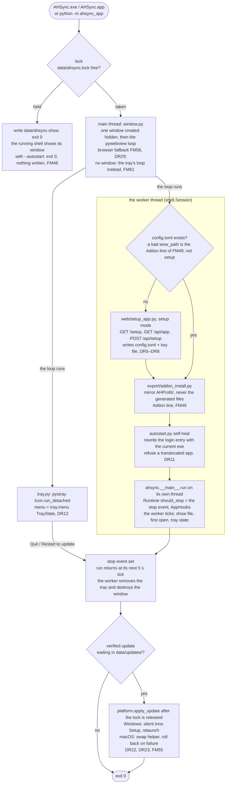

# Architecture

The high-level design: components, boundaries and data flows, kept current with every milestone. The detail lives in [SPEC.md](SPEC.md) (§5.0 components and contracts, §5.2 failure modes, §3.2 storage, §4.0 the app/addon split); this page is the map. Diagrams are Mermaid.

Maintenance rule (CLAUDE.md "How work is run"): a milestone that adds, removes or re-routes a component, a table family, a source or a contract updates this page in the same commit. The orchestrating model does it, never a routine subagent.

## 1. Components

Two programs and three data sources, talking only through files and versioned contracts.

```mermaid
flowchart LR
  subgraph Sources
    AHF[auctionhouse.fyi API + CDN<br/>hour/day candles, snapshot, Premium books]
    AHL[AHledger API<br/>price table, per-item history]
    Game[WoW: Forever client]
  end

  subgraph Addon["AHProfit (Lua, in game)"]
    Adapter[Core/Adapter*.lua<br/>every WoW API call]
    Capture[Capture/*<br/>events: purchases, posts, mail, crafts, loot, professions, inventory]
    Scan[Scan/Replicate.lua<br/>full AH scan -> order book]
    AEngine[Engine/*<br/>ports of Python formulas]
    Reselect[Recommend/*<br/>live reselection, graph repricing]
    UI[UI/*<br/>Portfolio tab, panel, tooltip]
    SV[(SavedVariables<br/>AHProfit.lua)]
    DataFiles[(AHProfit_Data/<br/>MarketIntelligence.lua, PortfolioPlan.lua)]
  end

  subgraph AHSync["AHSync (Python, desktop)"]
    Collect[collect/<br/>provider adapters, catch-up, scans]
    DB[(SQLite data/ahsync.db<br/>history, state, intelligence, plan)]
    Analysis[analysis/market.py<br/>statistics, patterns, volume]
    Intel[intel/<br/>MarketIntelligence contract + store]
    State[state/<br/>SavedVariables importer, journal, positions, sessions]
    Recommend[recommend/<br/>portfolio plan, pages, passes]
    Engine[engine/<br/>pure formulas and views]
    Export[export/<br/>addon data files]
    Web[web/ + app/<br/>dashboard server, refresh, scheduler]
    Shell[ahsync_app/ shell, setup, window, tray, start at login built M22–M24;<br/>update check and download built M25, install built M27<br/>around run; SPEC §3.7]
  end

  subgraph Cloud["Market cloud (AWS us-east-1; planned M30–M31, SPEC §2.4)"]
    BAPI[Blizzard Game Data API<br/>ruleset 2 · the Horde house · hourly Last-Modified]
    Collector[ahcloud/collector.py, built M30<br/>Lambda every 15 min · If-Modified-Since]
    Raw[(S3 data bucket, built M30: raw/ + state/<br/>one gzipped envelope per snapshot, kept forever)]
    Analyzer[ahcloud/analyzer.py, built M31<br/>daily: ingest → analysis → baselines, history.db round trip<br/>hourly per raw object: reprice_item + last hour, no database]
    IntelS3[(S3 intel bucket, built M30<br/>MarketIntelligence JSON by sha256 + latest-schema.json, M31)]
    CF[CloudFront, built M30<br/>public, the intel bucket only]
  end

  Dashboard[localhost dashboard<br/>the app window, or a browser]
  MCPS[mcp/ server, planned MC1–MC3<br/>in AHSync, 127.0.0.1:8766 while enabled<br/>read-only: pages, item, SQL + in-memory market_stats]
  Bridge[ahsync-mcp bridge, planned MC1<br/>stdio for Claude, key from data/mcp.json]
  Claude[Claude Desktop / Claude Code<br/>on the user's computer]
  GH[GitHub Releases, built M25<br/>update check, assets, SHA256SUMS]

  AHF -- until M35 --> Collect
  AHL -- until M35 --> Collect
  BAPI --> Collector
  Collector --> Raw
  Raw -- S3 event --> Analyzer
  Analyzer --> IntelS3
  IntelS3 --> CF
  CF -- collect/cloud_intel.py, built M32a --> Intel
  GH -- the update job in run, M25 --> Shell
  Shell -.planned.-> Web
  Shell -- installs the addon, M22 --> DataFiles
  Game --> Adapter --> Capture --> SV
  Game --> Adapter --> Scan --> SV
  SV --> State
  Collect --> DB
  State --> DB
  DB --> Analysis --> Intel --> DB
  DB --> Recommend --> DB
  Engine -.used by.-> Analysis
  Engine -.used by.-> Recommend
  DB --> Export --> DataFiles --> AEngine
  DataFiles --> Reselect --> UI
  DB --> Web --> Dashboard
  DB -. read-only, planned MC1 .-> MCPS
  Claude -. stdio .-> Bridge -. 127.0.0.1 + key .-> MCPS
```

Boundaries that matter:

- `engine/` is pure: data in, numbers out, no I/O or clock. Every displayed number is made there (SPEC §8.5).
- I/O lives at the edges (`collect/`, `db/`, `history/`, `state/`, `intel/store.py`, `export/`, `web/`), each taking a transport, clock or database so tests inject fakes.
- The addon touches WoW only through `Core/Adapter*.lua`; the addon only looks up and compares, never computes history (SPEC §4.0, §5.1).
- Sources are interchangeable behind the source tag (`src`) on every stored row; analysis picks by rule, never by name (SPEC §2.2, §5.0).
- **Planned (M28–M35):** the market cloud runs the same `collect/observations.py`, `db/` and `analysis/` code over a SQLite file in S3, and publishes `MarketIntelligence`; AHSync fetches it and keeps only the personalization. `ahcloud/` imports `ahsync`; nothing imports it back (AR9). Summaries are public; raw and state are private; no install holds an AWS credential (SPEC §2.4).

## 2. Market data flow: sources to intelligence to the addon

```mermaid
flowchart TD
  AHF[AHF hour files, snapshot, Premium books] -->|src ahf, kind hourly / book| Store
  AHL[AHledger price table every 30 min<br/>per-item history backfill] -->|src ahledger (table), ahledger_h1 (hourly)| Store
  Scans[Your full scans from SavedVariables] -->|src local, kind book| Store
  Store[(candles_h1 / candles_d1 / current<br/>scans + book_entries<br/>volume_d1 + volume_cover<br/>observed_hours)]
  Store --> Reads[history/reads.py<br/>one bulk read per market]
  Reads --> Pick["one close per (item, hour):<br/>kind book > hourly > table,<br/>then local, then config rank"]
  Pick --> Analysis[analysis/market.py<br/>medians, percentiles, 168-slot patterns,<br/>seasonality, sell windows, sales volume]
  Analysis --> Intel[(intel: MarketIntelligence<br/>one ItemIntel per item, versioned)]
  Intel --> Plan[recommend/portfolio.py<br/>candidates, selection, accounting]
  Intel --> Export[export/market_lua.py<br/>MarketIntelligence.lua]
  Plan --> ExportPlan[export/plan_lua.py, portfolio_lua.py<br/>PortfolioPlan.lua]
  Export --> Addon[Addon: tooltip, panel, live reselection]
  ExportPlan --> Addon
```

**Planned (M31–M32, SPEC §2.4): the cloud market's path.** The same flow, with the left half in the cloud:

```mermaid
flowchart TD
  BAPI[Blizzard: auctions + commodities of the house<br/>src blizzard, kind book, ids] -->|every 15 min, new Last-Modified only| Raw[(S3 raw/ envelope)]
  Raw -->|daily 09:00 UTC| Ingest[collect/observations.ingest_snapshot<br/>into state/history.db from S3]
  Ingest --> Analysis[analysis/market.py, unchanged: the baselines]
  Analysis --> Doc[(S3 intel/: MarketIntelligence JSON by sha256, schema 14<br/>(compact: rows, run-length profiles; 13 and 14 published)<br/>+ latest-schema.json written last)]
  Raw -->|hourly, S3 event| Hourly[reprice_item + last_hour + recent ring<br/>over the latest document, no database]
  Hourly --> Doc
  Doc -->|CloudFront, public| Poll[collect/cloud_intel.py<br/>every 15 min, If-None-Match, sha256, schema]
  Poll --> IntelLocal[(intel store: staged, then live;<br/>a cloud document kept as its downloaded gzip,<br/>a local one gzipped (SM2c),<br/>parsed once per process, SM1)]
  IntelLocal -->|incremental update| Plan[recommend/portfolio.py]
  Scans[Your scans] -->|overlay cur only, IU6| Plan
```

Rules encoded in this flow (SPEC references): the full refresh is the only heavy pass and runs once a day (§3.1.1); re-plans after a SavedVariables read touch only the plan and pages from the published intelligence, under one second (§3.1.2); publication is staging tables plus an atomic swap (§5.2); the addon files carry a schema and export version and the addon refuses mismatches (§3.5).

## 3. Player data flow: the game to positions, history and rates

```mermaid
flowchart TD
  Game[Game events] --> Capture[Capture/*: purchases, posts, auction mail,<br/>payouts, crafts, disenchants, sent mail,<br/>loot (gather), professions, inventory snapshots]
  Capture --> SV[(SavedVariables AHProfit.lua<br/>events kept until ingested)]
  SV -->|file watcher, 2 s debounce| Importer[state/importer.py<br/>idempotent by event id; ingestedUntil per character]
  Importer --> Journal[(state tables: journal, inventory,<br/>own_auctions, cost_basis, gather_events)]
  Journal --> Tracking[recommend/tracking_pass.py<br/>match events to plan actions]
  Tracking --> Positions[engine/positions.py + state/positions.py<br/>open on a funded buy or craft, replay lots and events,<br/>reconcile against snapshots]
  Journal --> Sessions[engine/sessions.py + state/gathering.py<br/>farming sessions: 20 units confirm, 15 min ends]
  Positions --> Accounting[committed capital = cost left of open positions]
  Accounting --> Plan[the portfolio plan]
  Positions --> History[History page: expected vs realized per position]
  Sessions --> Gathering[Gathering page: items/hr, net gold/hr]
  Importer -->|re-plan| Plan
  Plan --> Export[PortfolioPlan.lua]
  Export --> AddonLocal[Addon: local positions until AHSync reads them]
```

Rules: a sale is never inferred from missing inventory alone (§3.4D.9); events are never deleted before AHSync has stored them (§2.2 pruning handshake); the addon's newer events win over an older snapshot until the next export (§4.0).

## 4. Scheduling and the dashboard

```mermaid
sequenceDiagram
  participant S as app/scheduler.py
  participant C as collect/
  participant R as app/refresh.py
  participant P as recommend passes
  participant W as web/server.py
  S->>C: hourly :06 store hour (AHF), every 30 min AHledger table
  S->>R: daily full refresh (analysis, intelligence, plan, pages, export)
  Note over S,R: SavedVariables changed -> state import -> re-plan -> pages -> export
  S->>P: hourly status pass (positions re-evaluated, Status lines)
  W->>W: GET pages serve stored JSON (<= 50 ms); POST only for risk tolerance and manual rates, Host/Origin/token checked
  Note over S,W: built M23: GET /setup, GET /api/app, POST /api/setup (web/setup_app.py, same checks); built M24: POST /api/autostart (AppHooks from the shell); built M25–M27 (§3.7): /api/update/{restart,auto,channel}
```

## 5. Storage families (SQLite)

| Family | Tables | Written by | Read by |
|---|---|---|---|
| Market history | `candles_h1`, `candles_d1`, `current`, `scans`, `book_entries`, `volume_d1`, `volume_cover`, `sales_h1`, `lifetimes_d1`, `new_listings_d1`, `observed_hours`, `ahledger_rows`, `source_state`, `sync_state`, `fetch_failures` | `collect/` | `history/reads.py` |
| Items | `items` | `collect/` | everywhere, via the catalog |
| Intelligence | `intel` (+ `_new` staging; a cloud document's body is its gzip as downloaded, SM1; a local one's gzipped, SM2c) | `analysis/` via `intel/store.py`, `collect/cloud_intel.py` | `recommend/`, `export/`, `web/` (one parsed record per process, `IntelCache`) |
| Player state | inventory, journal (`purchases`, `posts`, `auction_mail`, `payouts`, `crafts`, `disenchants`, `mail_sent`), `professions`, `recipes`, `known_recipes`, `characters`, `cost_basis`, `gather_events`, `farming_sessions`, `manual_rates`, `positions`, `position_lots` | `state/` | `recommend/`, `app/` |
| Plan and pages | `actions`, `alternatives`, `export_candidates`, `portfolio_snapshot`, `views` (+ `_new` staging), `item_rules`, `reserves`, `sell_records` | `recommend/` | `export/`, `web/` |
| Operations | `status`, `meta` (the `update.*` keys, M25), backups on disk, raw snapshots on disk, `<data>/updates/` (the verified download, M25) | all | Status page |

## 6. Distribution and runtime (M22–M27 built, SPEC §3.7)

Each part is marked built in the milestone that lands it; the rest is **planned**. The rule: one shared core, a thin layer per OS. `ahsync/` stays standard-library only; `ahsync_app/` is the one package allowed third-party imports (pystray, Pillow, pyobjc), and `ahsync_app/platform/` is the one place that knows the OS (convention test DR16).

### 6.1 The app shell and tray around `run()`



**Built (M22):** the lock and the show file (FM48), the addon install (`export/addon_install.py`, FM49) and `run()` on a worker thread with the shell ticking on the main thread (`ahsync_app/shell.py`, `__main__.py`); no window or tray yet: a manual launch opens the browser once the dashboard answers, and a missing `config.toml` was refused until setup mode landed. **Built (M23):** setup mode (`web/setup_app.py` on the dashboard's port, with `server.py`'s Security checks; `app/setup.py` writes `AddOns`, `config.toml` and the key file; `app/wow_paths.py` detects and checks the folder), the hand-over to `run()`, and `GET /api/app` from `ahsync_app/app_info.py` in both modes. **Built (M24):** the window (`ahsync_app/window.py`) whose loop owns the main thread from the start, so setup shows in it too; the tray (`tray.py`) detached under it; the worker (`shell.Session`) running setup or the addon install, the self-heal (`autostart.py`) and `run()`; Quit and the stop file end the worker, which destroys the window; the browser fallback (FM56). The update half of the chart is planned.

From source `python -m ahsync` is unchanged (`./data`, `./config.toml`, no tray). The per-user folders come from `platform.current().app_dirs()`: `%LOCALAPPDATA%\AHSync` and `~/Library/Application Support/AHSync` (DR1).

### 6.2 The platform layer

```mermaid
flowchart LR
  subgraph Shared["shared, OS-free (tested once)"]
    ShellM[ahsync_app/shell.py]
    AutoM[ahsync_app/autostart.py]
    SetupM[ahsync/app/setup.py<br/>wow_paths.py]
    UpdM[ahsync/app/updater.py]
  end
  subgraph Platform["ahsync_app/platform/ (facts and thin writers)"]
    Base[base.py: Platform protocol, eleven members<br/>app_dirs, wow_candidates,<br/>autostart_enable / disable / enabled,<br/>restrict_file, run_location_problem,<br/>update_asset_name, verify_update, apply_update,<br/>ca_bundle]
    Win[windows.py<br/>LOCALAPPDATA, winreg Run key,<br/>Program Files WoW candidates,<br/>silent installer]
    Mac[macos.py<br/>Application Support, LaunchAgent plist (no launchctl),<br/>/Applications WoW candidates, translocation,<br/>codesign + Team ID, swap helper]
    Cur[__init__.py current<br/>the one sys.platform read]
  end
  ShellM --> Base
  AutoM --> Base
  SetupM --> Base
  UpdM --> Base
  Cur --> Win
  Cur --> Mac
  Win -.implements.-> Base
  Mac -.implements.-> Base
  Fakes[tests: fake Run key, plist folder,<br/>recorded run, fake filesystem] -.inject.-> Win
  Fakes -.inject.-> Mac
```

**Built (M22):** `base.py` (the protocol; the update members raised until M27, built since with `can_replace` and `forget_previous`), `app_dirs`, `wow_candidates`, `restrict_file` and `run_location_problem` in both modules, and `current()`; the guardrail DR16 in `tests/test_conventions.py`. **Built (M24):** the start-at-login members (Windows: the Run key through an injected `RunKey`; macOS: the LaunchAgent file alone) and `ahsync_app/autostart.py` over them.

Both OS modules are tested on every OS by injection (DR9–DR11, DR22, DR23), so a Windows-only CI run still tests the macOS adapter.

### 6.3 Update check, download and install

```mermaid
sequenceDiagram
  participant S as app/scheduler.py
  participant C as app/update_check.py
  participant GH as GitHub Releases
  participant E as engine/updates.py
  participant U as app/updater.py
  participant M as meta (update.*)
  participant Sh as ahsync_app/shell.py
  participant P as platform.current()
  S->>C: the update job, every 10 min from start, only with the app shell; sends at most daily (not within 24 h; never for 0.0.0 or update_check = false)
  C->>GH: stable: GET releases/latest · beta: GET releases?per_page=20 (If-None-Match)
  GH-->>C: 200 tag_name, html_url, assets · or 304 · or failure (FM52: one log line, "not checked …")
  C->>E: compare vX.Y.Z with the running version (numeric; suffixed tags ignored; never equal or older)
  E-->>C: newer? texts: "AHSync 0.4.0 is available · you run 0.3.1", pill
  C->>M: update.tag, update.url, update.etag, update.checked_ms
  alt auto_update on and newer
    U->>GH: GET SHA256SUMS, GET the OS asset (update_asset_name) into data/updates/*.part, rename
    U->>P: verify_update: hash against SHA256SUMS; macOS codesign --verify --deep --strict + Team ID (DR23)
    U->>M: update.downloaded → "AHSync 0.4.0 downloaded · installs at the next start · you run 0.3.1", pill "update ready · 0.4.0", Restart to update
  else failure (FM53)
    U->>M: delete the file · "Update to 0.4.0 failed: <reason> · still on 0.3.1 · tries again tomorrow"
  end
  Sh->>Sh: next start, or Restart to update (tray, POST /api/update/restart): run() returns, lock released
  Sh->>M: update.pending = 0.4.0
  Sh->>P: apply_update(path, exe): Windows silent Inno Setup + relaunch · macOS swap helper, roll back on failure (FM54, FM55)
  Sh->>Sh: next start: running the pending version → "Updated to AHSync 0.4.0 · today 06:02", else "Update to 0.4.0 failed · still on 0.3.1 · tries again tomorrow"
```

Channel rule (DR25, DR26): the stable channel sees only promoted releases (`releases/latest` skips pre-releases); the beta channel takes the highest `vX.Y.Z` of the list, pre-releases included; switching back never downgrades.

**Built (M25):** the check (`app/update_check.py`, one plain GET through the transport, never `ApiClient`: no AHF key, no retries), the texts (`engine/updates.py`), the download and hash check (`app/updater.py`; the platform's `update_asset_name`; `verify_update` accepted until M27), the state in `meta` `update.*`, read by `GET /api/app`, the Status card (`app_view.app_card` in the Status payload), the top bar's pill and the tray (`DashboardApp.tray_facts`); the toggles `POST /api/update/auto` and `/api/update/channel`, shared with the tray through `AppHooks.dashboard_ready`. **Built (M27):** the install half. `ahsync_app/shell.install_waiting` runs at a start before `run()`, or after `Session.run()` returns and the lock is released when Restart to update was asked (never on any other quit, FM78), reopening the database with `open_server_db` (no migration); it sets `update.pending` through `app/installer.install` and hands the verified download to the platform's `apply_update` (Windows: silent Inno Setup with relaunch; macOS: the `swap.sh` helper with roll-back). `installer.settle` runs first in every update job and records `updated_to`/`updated_ms` or the failed install at the next start. The platform gained `can_replace(exe)` (FM54, `update.cant_replace`) and `forget_previous(exe)`, so the protocol has thirteen members; `verify_update(path, exe)` does the macOS `codesign` and Team ID check. Restart to update (the tray, `POST /api/update/restart`) sets the stop event, so the same path runs.

### 6.4 CI, build, release and promote

Built (M26): `tools/build.py`, `tools/promote.py`, `packaging/`, the `build` and `release` jobs and `promote.yml`. The signed path is unverified until the first tag.

```mermaid
flowchart LR
  Push[push / pull request] --> Test[job test<br/>windows-latest + macos-15<br/>Python 3.12, Lua 5.1, pwsh tools/test.ps1]
  Test -- pull request, main, tag v*, workflow_dispatch --> Policy[tools/build.py policy, DR19<br/>sign: tag or sign:true<br/>preflight: main once a v* tag exists<br/>unsigned: everything else]
  Policy --> Build[tools/build.py build, DR17<br/>write ahsync/version.py<br/>pyinstaller packaging/ahsync.spec]
  Build --> SignMac[macOS, mode sign only, DR18<br/>temp keychain, codesign Developer ID + hardened runtime<br/>notarytool submit --wait, stapler staple<br/>dmg signed, notarized, stapled too<br/>keychain deleted]
  Build --> Pack[one packaging step per OS<br/>Windows: Inno Setup → AHSync-ver-windows-x64-setup.exe<br/>macOS: make_dmg.sh → .dmg, ditto → .zip]
  SignMac --> Pack
  Pack --> Art[upload-artifact]
  Art -- tag v* only --> Rel[job release, DR28<br/>tools/build.py release: SHA256SUMS,<br/>gh release create vX.Y.Z --prerelease --generate-notes<br/>notes start with the INSTALL.md link]
  Rel --> Beta[(GitHub pre-release = beta<br/>only beta-channel installs update)]
  Beta -- user tests on the Windows PC and the Mac --> Promote[promote.yml, by hand<br/>tools/promote.py vX.Y.Z, DR27<br/>gh release edit --prerelease=false --latest]
  Promote --> GA[(latest release = GA<br/>stable installs update within a day)]
  Secrets[/GitHub secrets: MACOS_CERT_P12, MACOS_CERT_PASSWORD,<br/>APPLE_TEAM_ID, NOTARY_KEY_ID, NOTARY_ISSUER_ID, NOTARY_KEY_P8<br/>values never in the repo, logs or artifacts/] -.-> SignMac
  Secrets -.-> Policy
```



Nothing is rebuilt at promotion: friends get exactly the files the user tested. Windows stays unsigned (SmartScreen once, `INSTALL.md`); the Windows signing steps are no-ops that a certificate can fill later.

## 7. Change log of this page

- 2026-11-01: created at the AHledger batch (SPEC draft v0.7); reflects M1–M18 built and M19–M21 planned (AHledger source, kind-based precedence, coverage card, backfill).
- 2026-11-01: M19 built: the AHledger adapter (`collect/ahledger.py`), schema 24 (`ahledger_rows`, `source_state`, `observed_hours`), kind-based precedence (`collect/provider.py`), the 30-minute poll hook.
- 2026-11-01: M20 built: the Data coverage card (`engine/coverage.py`, read from `observed_hours` by `history/reads.py`, drawn on the Status page); no component or flow changed.
- 2026-11-01: M21 built: the AHledger history backfill (`collect/ahledger_backfill.py`), driven by the scheduler every 5 s and sharing the paced AHledger client with the table poll.
- 2026-11-01: packaging batch spec merge (SPEC §3.7, M22–M27 planned): §6 added with the app shell and tray around `run()`, the platform layer, the update check / download / install flow and the CI build / release / promote pipeline, all marked planned; §1 gains the `ahsync_app/` shell and GitHub Releases as dashed, planned nodes; §4 notes the planned endpoints; §5 the planned `meta` keys and `data/updates/`. Each milestone marks its part built here.
- 2026-11-01: plan review before M22: §6.1 corrected so setup mode is entered only when `config.toml` is missing (a bad `wow_path` is FM49's Addon line) and a `--autostart` launch that finds the lock held exits silently (FM48); no component changed.
- 2026-11-01: plan review: the dashboard shows in the app's own window (`ahsync_app/window.py`, pywebview) with the tray detached under its loop; a second launch signals the running shell through `data/ahsync.show` (§6.1).
- 2026-11-01: M22 built: the shell without window or tray (§6.1's lock, show file, addon install and worker thread), the platform layer's folder members (§6.2) and the CI `test` job (§6.4's first box); §1's shell node and its addon edge drawn built.
- 2026-11-01: M23 built: setup mode and its hand-over (§6.1), `GET /api/app` and `POST /api/setup` (§4), with `web/setup_app.py` as setup mode's own request handler next to `server.py`.
- 2026-11-02: M24 built: the window, the tray and start at login (§6.1 redrawn: the window's loop takes the main thread first and setup, the addon install, the self-heal and `run()` move to the worker); `POST /api/autostart` through the shell's `AppHooks` (§4); the macOS login entry is the LaunchAgent file alone, no `launchctl` (§6.2).
- 2026-11-02: M26 built: §6.4's pipeline (the policy, the build per OS, the release, promote); the build job also runs on pull requests, unsigned; the dmg is signed and notarized itself before stapling.
- 2026-11-02: M25 built: §6.3's check and download half and GitHub Releases as a source of §1 (the update job in `run()`, only with the app shell); `meta` `update.*` and `<data>/updates/` in §5; the update toggles in §4.
- 2026-11-02: first Mac run fixes: the platform protocol's eleventh member `ca_bundle` (§6.2; TLS certificates for a build, FM58); the dashboard binds without a name lookup (FM59); the window accepts pywebview's `wkwebview` (FM60).
- 2026-11-03: without a window the tray's loop takes the main thread (§6.1, FM61); the shell holds the log for its whole run (FM62).
- 2026-11-03: the tray queues its AppKit work onto the main thread on macOS (FM65); the shared `NSApplication` of §6.1 is checked on the Mac.
- 2026-11-03: a tray click runs the shell's action on its own thread (§6.1, FM66).
- 2026-11-03: `ahsync_app/gui_thread.py` holds the main-thread queue the window and the tray share, and the Dock icon follows the window (§6.1, DR31).
- 2026-11-06: Blizzard cloud batch spec merge (SPEC §2.4, M28–M35 planned): §1 gains the market cloud subgraph (Blizzard API, collector, raw, analyzer, published summary, CloudFront) as dashed planned nodes, with the AHF and AHledger edges marked "until M34"; §2 gains the cloud market's path. Each milestone marks its part built here.
- 2026-11-06: the cadence split (SPEC §2.4, plan §1): the analyzer runs daily for the baselines and hourly for the state over one document; §1's analyzer node and §2's cloud path redrawn; horizons and regimes planned as M34, removal M35.
- 2026-11-06: M30 built: the stack (`infra/`), the collector and the stores (`ahcloud/`); two buckets (data private, intel served by CloudFront only), since an origin access control can't be scoped to a prefix; the analyzer's resources come with M31.
- 2026-11-06: M31 built: the analyzer (`ahcloud/daily.py`, `hourly.py`, `publish.py`, `analyzer.py`) and its stack resources; the hourly mode reprices through `analysis.market.reprice_item` (not `with_scan`, which doesn't reprice); the daily run carries the hourly fields.
- 2026-11-06: M32a built: AHSync reads the published summary (`collect/cloud_intel.py`, `app/cloud_job.py`), stages it with the re-plan and rewrites the addon files; ages count back from the document's `ages_at_ms`; in-game scans reprice.
- 2026-11-07: tooltip and flips spec merge (`docs/plans/tooltip-and-flips.md`, M36–M38 planned): the summary's schema 11 (`med14`, published beside 10 during the transition) drawn on §2's document node; no component or flow changes.
- 2026-11-07: M36 built: the summary is schema 11 (`med14`), published beside schema 10 (`ahcloud.publish.PUBLISHED_SCHEMAS`); the market file carries `med14` as its last field; the addon tooltip is laid out anew (no component or flow changes).
- 2026-11-07: M33a built: id volume comes from auction lifetimes (`engine/volume.lifetimes`, `collect/observations.recompute_id_days`), with two new market-history tables, `lifetimes_d1` (ended, expired and matched listings) and `new_listings_d1` (new listings' positions against the book, for the measured undercut share); the summary is schema 12, published beside 10 and 11. No component or flow changes.
- 2026-11-07: M39 built: a CloudWatch alarm for 3 hours without a published market summary (`NoMarketSummary`, FM77); no component or flow changes.
- 2026-11-07: M32b built: a cloud market's freshness pill (D100) and its Data coverage row from the summary's coverage (D99); A92 and BZ25 split off as M32c. No component or flow changes.
- 2026-11-07: M40 and M32c part 2 built: two contract changes on the addon boundary. The market file (`EXPORT_VERSION` 5) ends each item in `salesDays`; the addon's `itemNames` rows carry the game's vendor price and class, which the importer writes into the local catalog's gaps (`items.vendor_src`, schema 26), the cloud summary and AHF's list still winning. No component or flow changes.
- 2026-11-07: M27 built: the app installs its own updates. At the next start (or on Restart to update, after `run()` returns and the lock is released), `ahsync_app/shell.install_waiting` hands a verified download to the platform (Windows: silent Inno Setup with relaunch; macOS: the `swap.sh` helper with roll-back); the update job's `installer.settle` records the result at the next start. Restart to update (tray, `POST /api/update/restart`) stops the app the same way. No other component or flow changes.
- 2026-11-07: M33b-1 built: commodity cancels leave `sold` and sell-through is kept per lookback (`engine/sell_through.py`); the `lifetimes_d1` table gains cancels and tier-1 endings (schema 27), and the summary is schema 13 (published beside 10-12) with the inputs of the tooltip's new market lines. No component or flow changes.
- 2026-11-08: MS0 spec merge: the market simulator is planned (SPEC §8.10, SCENARIOS §6, `docs/plans/market-simulator.md`): test tooling under `tools/sim/` that feeds simulated raw snapshots to the unchanged cloud job and plan; no component, flow or contract changes.
- 2026-11-08: MS1 built: the market simulator's core (`tools/sim/`: the truth log, the seeded market model, Blizzard's snapshots and raw envelopes, the cloud job run in-process with a catalog stand-in); test tooling only, no component, flow or contract changes.
- 2026-11-08: SM1 built: a cloud summary is stored as its downloaded gzip and parsed once per process, the scheduler's and the dashboard's connections sharing one record (`intel/store.py` `IntelCache`; BZ42, BZ43).
- 2026-11-08: SM2a built: the cloud publishes only schema 13 (`ahcloud.publish.OLDEST_PUBLISHED`), since the releases that read 10 to 12 refuse documents of the summary's size; no component or flow changes.
- 2026-11-08: SM2b built: the summary is schema 14, the compact form (items as rows under `item_fields`, run-length profile strings), published beside 13; no component or flow changes.
- 2026-11-08: SM2c built: a local market's summary is stored gzipped in `intel.body`, as a cloud one is; no component or flow changes.
- 2026-11-08: BZ45's display (D106): the id pass stores each day's estimated unseen units (`volume_d1.unseen`, database schema 28) and the market summary carries `unseen_per_day` per item (summary schema 15, BZ49; published beside 13 and 14); the item detail reads it. A contract change on the summary; no component or flow changes. Deploy the cloud analyzer before the desktop release that reads schema 15.
- 2026-11-08: MS2 built: the simulator's fitting from collected raw (`tools/sim/fit.py`), the SM rows' measures against truth (`tools/sim/inference.py`) and the inference report (`tools/sim_report.py`); test tooling only, no component, flow or contract changes.
- 2026-11-08: MS3 built: paper trading in the simulator (`tools/sim/trader.py`, `scorers.py`, `decision.py`; `tools/sim_report.py decision`): synthetic characters write SavedVariables that AHSync imports, tracks and re-plans on, as in production; test tooling only, no component, flow or contract changes.
- 2026-11-08: MC0 (the AI assistant batch, `docs/plans/mcp-server.md`, SPEC §3.8): planned the `mcp/` server inside AHSync (127.0.0.1 only, only while enabled, read-only) and the `ahsync-mcp` bridge Claude launches; drawn dotted as planned.
